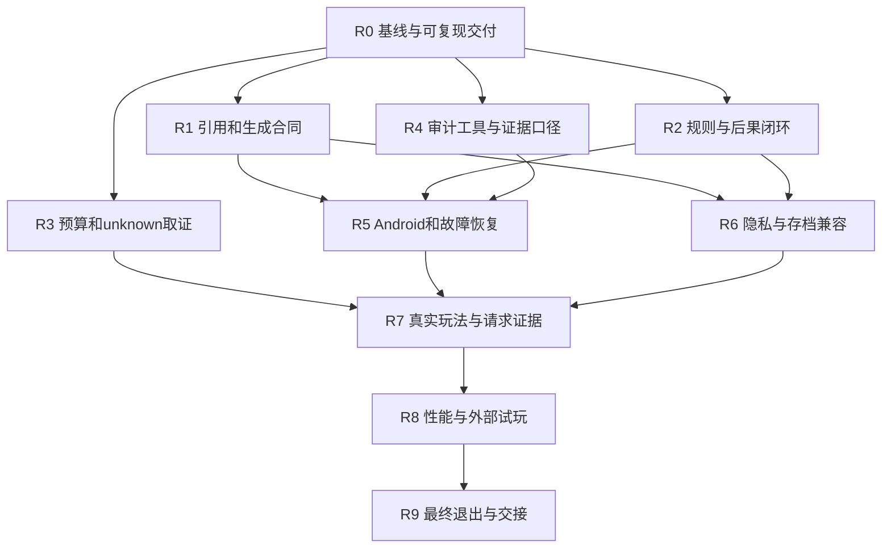

# Shine-TRPG 阶段 9.5 收口建设方案

> 版本：V1.0｜编制日期：2026-10-15｜状态：待实施提案  
> 适用仓库：<https://github.com/anjingdtl/ShineWord>  
> 审计基线：`44e74da06be36498bc9de74db51533a3f979bbc5`  
> 最后核实远端 main：2026-10-15 19:24，北京时间，HEAD 未变化。  
> 适用环境：Windows / Linux / macOS 开发环境、云端工程环境及具备合法访问条件的 Android 测试环境。路径、设备、模型和凭据位置均在执行时发现并登记，不绑定某台开发机。  
> 本文件是建设与验收计划，不是完成报告；撰写本文件未修改项目仓库、运行真实模型或操作设备。实施授权以届时用户指令和环境权限为准，本文不单独授予付费调用、用户数据迁移、合并或发布权限。

## 0. 执行摘要

阶段 9.5 当前为 **PARTIAL，尚未完成关闭**。本轮任务是在既有架构内完成缺陷修复、端到端恢复、证据校准和体验验收，形成可以交接、可以复验的关闭结论。

保留已经确定的职责：

- **模块化 RPG Runtime**：规则、资格、骰点、效果、进度、后果和原子状态提交。
- **Narrative Graph Engine**：从既有计划、局面、任务和当前权威状态派生故事机会；保持只读投影。
- **LLM Creative Layer**：在冻结材料与预算内生成受限候选和叙事；无权直接宣布状态成功。

优先顺序：

1. 修复远端 Core CI 中已确定的角色候选去重失败，建立可复现提交。
2. 修复或证伪规划引用、完成条件、有限供给和一次性收益的合同缺口。
3. 修正旅程审计对后果生命周期的识别，隔离历史账本差异和 unknown。
4. 在固定源码/APK 身份上完成 Stage-8、Stage-1、A15/A28、隐私、存档与故障恢复。
5. 补齐 L1 请求证据、分支汇合、两条后果消费链、两题材样本、性能和外部试玩。
6. 分别给出阶段 9.5 与阶段 9 遗留合同的退出状态，禁止互相替代。

**不以增加模块数量、测试总数、模型调用数量或故事回合数作为完成依据。**

---

## 1. 已核实基线与证据边界

### 1.1 远端基线

| 项目 | 当前核实结果 |
|---|---|
| 仓库 | `anjingdtl/ShineWord` |
| 主分支 | `main` |
| HEAD | `44e74da06be36498bc9de74db51533a3f979bbc5` |
| 已知收尾提交是否在历史中 | PASS：该提交就是审计时 main HEAD |
| 提交时间 | 2026-10-15 18:12:33，北京时间 |
| Core Verify | **FAIL**：1314 项，1313 PASS、1 FAIL；后续版本检查步骤被跳过 |
| Android Verify | **PASS，仅移动类型检查和 Debug 构建层** |
| 当前应用版本 | 根/移动 package 声明 1.0.0；旧文档仍存在不同版本表述 |
| 数据协议 | `shineword-save-10`；内置数据库迁移 101＋102 |
| 9.5 最新报告结论 | PARTIAL |
| 私有运行态证据 | 未纳入仓库；本次未独立核验 DB、模型原始响应、私有预算账本、APK和设备截图 |
| 工作树状态 | 不宣称任何开发机干净；施工环境必须重新检查 |

CI 链接：

- [Core Verify / 38718795688](https://github.com/anjingdtl/ShineWord/actions/runs/38718795688)
- [Android Verify / 38718795743](https://github.com/anjingdtl/ShineWord/actions/runs/38718795743)
- [基线提交](https://github.com/anjingdtl/ShineWord/commit/44e74da06be36498bc9de74db51533a3f979bbc5)

报告中的“1325/1325”对应当时含未提交修改的工作树，不能覆盖当前远端 CI 结果。最新验收矩阵另有“1322/1322”历史引用。数量差异的完整来源仍须通过源码/测试清单核对，不能只凭差值推断遗漏了哪些测试。

### 1.2 状态与证据等级

状态采用：

| 标签 | 使用条件 |
|---|---|
| PASS | 本项合同要求的证据完整，结果满足标准，身份可追溯 |
| FAIL | 有可复现反例或可靠运行证据直接违反合同 |
| PARTIAL | 已完成一部分，尚不能覆盖整项合同 |
| NOT RUN | 计划中的检查或测试尚未执行 |
| BLOCKED | 缺外部资源、权限、输入或必要前置条件；注明阻断原因和恢复条件 |
| UNKNOWN / NOT VERIFIED | 事实不能从现有证据确认；不补造结论 |
| NOT NEEDED | 仅用于有条件建设项，记录未触发条件和重新评估条件；不冒充 PASS |

证据独立登记七类：**代码、自动化测试、构建/APK、模拟器 UI、真实模型请求、真实完整旅程、外部试玩**。真实 Android 设备还须注明“模拟器/真机”，不得把模拟器写成真机。

这些类别不能简单逐级替代：构建成功不能证明 UI 可用；主机生产 Session 调用了真实模型，也不证明设备 UI 已走通；真人说好玩不能证明事务无重复提交。

“仓库中的报告写了 PASS”只证明存在该报告记录；缺少底层证据时，保留报告归属，另标本次独立验证状态。

### 1.3 必读材料与优先关系

施工时先读取执行环境及仓库内适用的 `AGENTS.md` 和项目约定，再读取：

1. `progress.md`。
2. `docs/reviews/phase9-5/closeout-2026-10-15/{FINAL_REPORT,ACCEPTANCE_MATRIX,TEST_REPORT,CHECKPOINT}.md`。
3. `docs/Shine-TRPG_PHASE9_5_MODULAR_GRAPH_RUNTIME_PLAN_V2.md`。
4. `docs/Shine-TRPG_PHASE9_CONSTRUCTION_PLAN.md`。
5. `docs/Shine-TRPG_PHASE9_FULL_PASS_CLOSEOUT_PLAN.md`，包括已批准的 A1/C-2 调整。
6. `docs/reviews/phase9-5/{MODULE_OWNERSHIP,M3_DECISION,ROOT_CAUSE_AUDIT_2026-10-13}.md`。
7. 当前 README、版本规范、数据库/存档常量、package脚本、CI工作流。

冲突处理：当前代码决定“现在实现了什么”；已批准建设合同决定“还须达到什么”；实际身份匹配的测试和运行证据决定“证明了什么”。历史描述不能覆盖当前反例，也不能仅因旧文档较严格就未经核实扩大合同。

旧提示词如无法取得，登记未知要求并由产品负责人确定范围继承；不因此停止已明确的工程修复，也不宣称已逐字满足缺失提示词。

---

## 2. 目标、范围与关闭口径

### 2.1 目标

让玩家能够在现有产品范围内稳定完成：准备战役、合法行动、规则结算、叙事呈现、后继供给、中断恢复、后果回响和自然结束。

阶段收口必须回答：

- 当前可交付提交是否真的全绿，是否可独立构建？
- 模型输出是否合法、是否已采用、是否实际进入可玩路径？
- 普通成功和合法失败能否产生可解释的变化？
- 过去选择是否真的改变后续机会、条件或代价？
- 中断后是否恢复原合同与骰点，且没有重复付费或奖励？
- 外部玩家能否理解目标、变化、下一步和选择代价？

### 2.2 范围

- 已确定工程缺陷与已入库阶段验收缺口。
- 战役/后继计划生成、校验、修复、采用的合同一致性。
- 玩家资格、四档效果、一次收益、延迟后果及分支隔离。
- 持久化、恢复、并发、存档和 Android 状态接线。
- 模型/预算账本取证和不会制造假 PASS 的验收工具。
- 有界的真实模型、真实旅程、性能和四名独立试玩。

### 2.3 非目标

- 不另建状态权威、持久图引擎或完整剧情 DSL。
- 不扩大为阶段10产品开发，不重做整体UI和TXT构建架构。
- 不新增多服务导演链、联网多人、云端账户或商业化系统。
- 不为了覆盖率给缺信息的 Method 填默认难度、默认证据或默认成功。
- 不自动重放 unknown、不手工改账、不修改旧骰点、历史回合、已采用工件。
- 不引入机械回合配额、固定阶段长度或人为计数增长来制造可玩性。
- M3保持条件性决策；一个候选校验失败不足以证明需要新生成架构。

### 2.4 两套关闭结论，禁止隐式转移遗留

| 结论 | 必须满足 | 不能替代的内容 |
|---|---|---|
| 工程修复可交接 | 当前身份工程门禁通过；故障与证据清单明确 | 不代表9.5整体关闭 |
| 阶段9.5关闭 | 原G0–G4、适用V95-01～12及本方案恢复/数据补充门完成；M3可有依据地NOT NEEDED | 不自动宣称阶段9的80决定、A01–A40全部通过 |
| 阶段9遗留合同关闭 | A01–A40及已批准真实旅程/性能合同逐项完成 | 不用较短的9.5竖切替代 |
| 9/9.5全面收口 | 上述两阶段均关闭，外部依赖有实际证据 | 不以“代码已写完”代替 |

本方案安排两阶段共同需要的工作一次取证、分别判定。若9.5自身通过但原阶段9仍有独立缺口，报告必须同时标出；不得为了更名阶段而消失遗留事项。

---

## 3. 不绑定开发机的执行与接续规范

### 3.1 执行环境能力分级

| 能力层 | 最低条件 | 可以完成 | 缺失时处理 |
|---|---|---|---|
| 工程环境 | Git、受支持Node/npm、仓库读取、隔离测试目录 | 代码修复、确定性测试、SQLite集成、证据工具 | 修复环境后继续；不能冒称已跑测试 |
| Android构建环境 | 仓库规定JDK、SDK/NDK/Gradle、依赖访问 | mobile类型、APK构建、身份清单 | 可交给CI或另一机器，记录交接身份 |
| 设备环境 | 可访问的Android模拟器或真机、adb/等效工具 | UI、生命周期、安装和恢复测试 | BLOCKED-DEVICE，不阻止独立工程工作 |
| 模型环境 | 用户授权的模型/profile、素材、预算、网络 | 真实生成与旅程 | BLOCKED-MODEL/BUDGET；使用合成夹具完成离线部分 |
| 外部试玩 | 未参与施工的真实人员、稳定测试包 | 四问、六维评分、体验反馈 | BLOCKED-HUMAN，不伪造参与者 |

不得假定某路径存在、某设备序列号永久在线、某端口空闲、某私有文件已同步或某机器已安装旧APK。

### 3.2 参数发现与登记

下列名称是本方案的逻辑参数，不表示现有脚本已经支持同名环境变量；实施者须映射到实际脚本参数，不可虚构已有命令。

| 参数 | 获得方式 | 公开记录范围 |
|---|---|---|
| REPO_ROOT | 当前Git仓库发现或用户明确指定；核对origin | 可记录环境别名；不要求暴露个人目录 |
| BASE_SHA / TEST_SHA | 远端main与测试提交实际查询 | 完整SHA |
| QA_ROOT | 执行者选择的独立受控目录 | 记录逻辑位置与访问责任人 |
| DEVICE_SERIAL | 枚举设备后明确选择 | 测试环境中记录；公开报告可脱敏 |
| APK_PATH | 当前构建输出实际发现 | filename、SHA256、bytes |
| MODEL_PROFILE | 用户已授权配置、安全存储引用 | endpoint脱敏身份、model、能力来源、推理档、指纹 |
| SECRET_REFERENCE | 用户安全存储或已有授权配置 | 只记录引用，不记录密钥内容 |
| SOURCE_INPUT | 用户有权使用的TXT或合成夹具 | hash、编码、码点范围、授权状态 |
| BUDGET_SCOPE | 本轮独立批准的scope | cap、已用、未决、停止阈值，不记录secret |
| EVIDENCE_ROOT | 受控证据目录 | 公开索引使用相对逻辑路径和hash |

首次接手只读检查：

```text
git rev-parse --show-toplevel
git remote -v
git branch --show-current
git rev-parse HEAD
git status --porcelain=v1
git diff --stat
git ls-remote origin refs/heads/main
```

这些是独立查询，执行器须检查每个退出码。若本地 origin/main 未刷新，不把它当远端当前值。网络受限时可用授权GitHub连接器查询，记录替代方式。

准备施工时，在已有授权范围内fetch并创建隔离工作分支/checkout；禁止reset、clean、强推或把他人脏改动整体纳入提交。已经存在可用隔离环境时复用，不要求为每个节点再建一个环境。

### 3.3 跨机器交接

可移交的核心是身份与证据，不是绝对路径。交接包包含：

- 源码提交、待提交差异的明确归属、依赖锁文件与工具版本。
- build输入清单、APK hash、安装包核对结果。
- 需求矩阵、失败用例、完成节点、下一条安全命令。
- 私有证据索引及授权的传输/访问方法，不把DB或密钥塞进公开仓库。
- 模型profile非敏感指纹、预算scope、剩余授权范围和unknown清单。

接收方必须重新核实远端和文件hash；换机器不产生新预算，不自动继承设备安装状态。私有SQLite如需分析，采用一致性备份或规范快照并考虑WAL，不能随意复制正在写入的主db文件后宣称完整。

用于设备恢复验收时，通过正式导入/恢复入口重建合法QA场景；把DB直接替换进用户App不能算恢复验收。专用夹具数据库只能用于受控诊断，证据等级明确标注。

### 3.4 无法取得历史私有资产

继续完成合成反例和新版本回归；历史精确场景保持NOT VERIFIED。新样本可证明当前代码行为，但不得冒充对原v18/v33存档的精确复现。后续仅依赖这些历史资产的结论单独BLOCKED，不让整个工程工作停摆。

---

## 4. 基线缺陷与风险登记

行号绑定本方案基线；后续代码移动时按符号重定位并更新证据。

| ID | 发现与证据位置 | 状态/证据 | 收口动作 |
|---|---|---|---|
| D01 | `session.ts:3710–3718`人物候选未去重；`tests/game-opening-chain.test.cjs:89–110`实际2、期望1 | FAIL：代码＋远端CI | 修候选入口，区分同人重复与同名不同人；不靠删实体通过 |
| D02 | 收尾报告1325、矩阵1322、当前CI1314；APK来自含未提交变更工作树 | PARTIAL：报告与身份不一致 | 建立干净提交的源码/测试/APK清单，核对遗漏依赖 |
| D03 | `candidateModel.ts:207–208、494–496`用非空字符串判引用；`localCompile.ts:185–187`查可见技能 | UNKNOWN：v18报告线索 | 取得原响应才确定根因；先补错误类型与引用矩阵，禁止盲目放宽正则 |
| D04 | `planValidation.ts:120–144、580–581`的生产者门不读取历史事件，payloadMatch存在时拒绝该事件叶 | PARTIAL：代码风险，未证明真实旅程已触发 | 合法历史事件、支持的payload、当前无生产者等完整入口反例 |
| D05 | `ordinaryCompletion.ts:43–46、69–76`为乐观供给上界，已有一次性供给修复 | PARTIAL：代码/测试 | 使用生产资格与结算做有界序列验证，不把上界当可完成性证明 |
| D06 | `promiseEffectPolicy.ts:37–45、59–121`与`routeReadiness.ts:93–115`已补一次性收益策略 | 旧问题已有修复：代码/定向测试 | 复核不对称等级、多方法共享事实、合法新收尾；不重复宣称旧漏洞必然仍在 |
| D07 | `settlement.ts:185–222`已应用/关闭后果；`consequenceLifecycle.ts:113–173`有cancelled/discharged | 已有实现：代码/自动化 | 精确复核旧后果，取消不能计成消费；新replan不可新造孤儿 |
| D08 | `tools/phase9-journey-audit.cjs:75–89`只计triggered，生产可同事务转discharged；测试52–60仍构造triggered | FAIL：工具合同静态反例路径；未测私有DB影响范围 | 先做生产Session→SQLite→audit回归，修漏计与去重 |
| D09 | `requestLedger.ts:127–130、198–223`保留unknown；`unknownReplayRecovery.ts:211–293`已有显式确认 | PARTIAL：代码/测试；历史记录未验 | 保留unknown，确认路径按任务和指纹验证，禁止自动重发 |
| D10 | v18#a1代理unknown、app429；`phase9-device-proxy.cjs:67–89`有headers/完成不同观察点 | UNKNOWN：报告线索 | 只读逐attempt对账；观察窗口是待验证假设，不是已证根因 |
| D11 | 最新收尾矩阵Stage-8、A15/A28、Stage-1仍未闭合 | PARTIAL/NOT RUN：报告 | 当前身份精确回放与故障矩阵；不通过补造成功状态解决 |
| D12 | `planningService.ts:120–168`与`generationService.ts:399–407`区分公开/策划材料，完整三意图隔离未验 | NOT RUN：高层验收 | 检查Planner/Narrator/UI/记忆/日志，不仅检查提示词文本 |
| D13 | `saveFile.ts:35、250–272、802–830`；`builtinMigrations.ts:1297`起 | PARTIAL：save10与101/102代码/SQLite测试 | 正式设备往返、fork、损坏数据、旧版本拒绝和unknown导出边界 |
| D14 | `moduleRegistry.ts:51`声明discoveredEntryIds；实际snapshot使用discoveries | PARTIAL：元数据不一致 | 校正归属说明/合同，评估对rules hash影响；不得冒充真正模块隔离 |
| D15 | README第8/12/34/38行及DEVELOPMENT_STATUS第3–9行状态/版本/协议过期 | FAIL：文档现状 | 保留历史，统一当前入口与身份，不覆写历史报告 |
| D16 | 四名独立试玩、两题材、匹配性能、真实L1分布未完整提供 | BLOCKED/NOT RUN | 外部资源与样本计划；不以实施者自评替代 |

所有生产修复均先用反例确认缺陷边界。风险条目可以被测试证伪；证伪后记录理由和证据，不为“完成清单”强行改代码。

---

## 5. 架构、状态与预算不变量

1. `GameStateSnapshot.campaignRuntime`为战役运行态权威，SQLite投影随原子提交同步。
2. 机会投影不保存第二套succeeded/failed状态。
3. 候选原始响应、解析结果、校验结果、采用与实际使用分别记录。
4. 生产链保持：Session资格→合同冻结→骰点日志→Prepared完整结算→Narrator→原子提交。
5. 恢复使用原冻结合同、同骰点；同turn只提交一次，outbox失败不得留下半提交。
6. 旧计划、artifact、正文、快照、骰点不可改写；未来修订通过正式采用。
7. unknown不等于失败、未发送或无费用。没有批准就不自动重放。
8. 真实请求全部走既有预算和账本，额外修复/后台/连接检测也计费。
9. 不在测试中修改用户真实DB、合法历史或预算数以制造PASS。
10. 四档等价使用同合同/同冻结状态/同骰流的确定性实验；不要求真实随机旅程自然复制同骰流。
11. 合法短篇提前结束保留；未满足长程样本配额时另选合法样本，不复活已结束故事。
12. 无数据不推断通过；代码修复、构建成功、设备可用、模型成功和体验通过分别判定。

---

## 6. 实施节点、依赖与门禁

### 6.1 总体顺序



依赖表示关闭门，不要求独立工作串行等待。例如设备缺失不妨碍R6的SQLite部分，历史账本未取得不妨碍R1确定性测试。不得在同一设备/同一真实分支上并发运行多个写入驱动。

### 6.2 节点总表

| 节点 | 优先级 | 角色类型 | 主要交付 | 关闭证据 |
|---|---|---|---|---|
| R0 | P0 | 维护者、工程QA | 基线、D01修复、身份差异清单 | 当前SHA Core/Android通过；版本检查实际执行 |
| R1 | P0 | 规划管线、核心QA | ID诊断、解析/修复完整入口测试 | 非法零采用、合法不误拒、预算有界 |
| R2 | P0 | Runtime、持久化QA | 有限供给/一次收益/后果语义回归 | 生产Session和SQLite闭环，无第二引擎 |
| R3 | P0 | 请求治理、审计 | 逐attempt对账、未决隔离和恢复边界 | 原账不改、未知不重派、费用口径可追溯 |
| R4 | P0 | QA工具、审计 | 修正journey audit、语义账和证据索引 | 生产事件与审计一致，漏计/重复0 |
| R5 | P0 | Android、恢复QA | Stage/A15/A28与状态UI验证 | 当前APK选择→骰点→叙事→提交→恢复 |
| R6 | P0 | 安全/持久化QA | 三意图隐私、save10/fork/迁移 | 泄漏0、历史损坏0、坏输入零写入 |
| R7 | P1 | 内容QA、旅程执行 | L1、汇合、后果、三意图和自然结局 | 真实模型与旅程独立证据 |
| R8 | P1 | 性能QA、独立试玩者 | 累积/匹配性能、两题材、四人反馈 | 数据和反馈符合既定合同 |
| R9 | P0出口 | 维护者、复核者 | 两阶段矩阵、最终报告、接续包 | 无被隐藏的FAIL/PARTIAL/BLOCKED |

责任是角色类型，可以由同一实施者承担多个工程角色；外部试玩者必须独立。是否使用多agent由用户和执行约定决定，本文不要求自动并行委派。

### R0：基线与可复现交付

**输入**：远端main、当前工作树、适用约定、现有CI。  
**修改边界**：角色候选列表及必要测试、确有遗漏的依赖、当前状态入口；不批量提交无关工作。

实施：

1. 记录远端HEAD、当前分支、dirty状态、工具链、协议常量和CI。
2. 在隔离checkout复现D01；核对`getWorldSetup`和`createCampaign`两个不同入口。
3. 设计可解释的同人重复判定。对同名不同人、别名冲突、可见性差异和排序稳定性保留反例。
4. 补最小修复，保留原entity/fact，不以数据删除实现去重。
5. 对报告工作树与远端缺口能取得的部分做清单，不能取得的标UNKNOWN。
6. 定向测试通过后执行完整工程门禁。

**PASS**：D01通过；无新失败；必要测试未跳过；版本检查真实执行；同一提交Core与Android成功；测试数量来自实际日志。  
**失败条件**：删断言、降低标准、只提交测试不提交实现、用本地dirty通过替代CI。  
**交付**：`BASELINE.md`、`DEFECT_REGISTER.md`、当前身份工程日志。

### R1：引用、候选修复与完成条件合同

**输入**：当前生产parser/compiler/job；v18原响应可选。  
**修改边界**：现有生成合同、结构化诊断和必要适配；不修改已采用候选。

必测引用类别：合法目录ID、目录允许的非ASCII ID、缺省/null、空白、数字、数组、对象、未知ID、不可见ID、过期ID、错误行动种类所带字段。

施工要求：

- 区分类型错误、空值、范围错误、不可见与行动参数要求。
- 若合同允许省略/null，按真实行动语义处理，不机械要求所有字段都有值。
- 空间、人物、技能引用以当前目录和绑定为准，不把显示名自动猜成ID。
- 开局、重规划、后继准备都走完整job链测试；原始响应保持不变。
- 首次无效→一次合法修复；修复仍无效→停止；修复中断→按缓存/unknown合同恢复。
- 维持现有任务预算，不因修复逻辑变复杂增加隐形次数。
- 对D04分别测试历史已提交事件、当前可产生事件、没有来源的事件、支持的payload过滤；经完整校验入口判断，不只单测一个helper。
- 取得v18脱敏原响应后才标“精确复现”；合成同形反例标“合成验证”。

**PASS**：非法候选采用数0；有效合同夹具全部通过；超预算派发0；HTTP200-invalid如实呈现；旧响应/历史修改0。  
**暂停**：需要协议变更或无法确定引用映射时先形成明确设计决策，不用宽松转换绕过门禁。

### R2：可执行路线、一次性收益与后果生命周期

**输入**：生产资格、效果编译、Prepared结算、SQLite提交；R1合同。  
**修改边界**：既有Runtime纯规则与共享谓词；不引入第二套状态机。

必须覆盖的对抗序列：

1. 一次承诺只提供一次计数/关系收益，不能被解释为无限准备。
2. 两个方法引用同一承诺或知识，不得把同一供给重复相加。
3. success/full_success不对称时仍不重复领奖。
4. 冗余已履约效果不能误挡新的独立阶段收尾。
5. 两条互斥关闭方法不能合并成一条虚构路线；关闭后不能继续刷方法。
6. 普通成功可完成，大成功可缩短路径；合法失败保留实际代价和新机会。
7. 新replan不得让原本可达的pending后果永久失去路径。
8. 历史已不可达后果按既有明确语义取消，保留条件和取消理由；cancelled不计discharged。
9. triggered→discharged实际效果只应用一次；同一事务关闭后仍可从事件追溯。
10. 同一分支与不同分支、不同revision、同ID不同内容严格隔离。

优先把生产函数作为回放对象。可加入有界搜索/模型检查，但输入状态、资格和转移必须复用生产实现；达到上限输出UNKNOWN，不宣称无解或可解。解析/生产者上界仍只作为必要性筛选，不能升级为充分证明。

`moduleRegistry`字段归属差异须核对真实writer并校正文档或元数据。若影响规则binding/hash，先评估旧存档与冻结合同兼容，不为名称整洁随意改版本。

**PASS**：上述序列每项有正/反例；重复收益0；新造孤儿0；合法独立收尾被误挡0；历史改写0；生产Session→SQLite结果一致。  
**交付**：合同反例表、调用链、生产集成测试、旧问题是否仍适用的结论。

### R3：预算差异、unknown与请求恢复

**输入**：授权只读账本、应用请求记录、冻结任务、响应hash；缺资产时先完成合成测试。  
**修改边界**：取证工具、错误分类、必要的生产恢复缺陷；禁止手工改原账。

逐attempt关联：scope、profile指纹、logicalRequestId、attemptId/attemptNo、requestKind、branch、发送/headers/body/持久化时间、HTTP状态、响应hash、候选状态。

对v18#a1只写可证事实：代理unknown与app429若均可核实则并列保留。headers到body完成间断连、账本落盘失败等只是候选原因，必须有时间线才能确认。对#a2保持“HTTP200但候选invalid”，不计成功采用。

历史planner/world_mapping unknown全部保持未决：不因代理200改成app成功，不因应用无正文按未发送释放预算，不以新scope覆盖旧成本。

现有正式恢复API已存在。验证预览→指纹→用户明确确认→关联新任务的合同：审批过期、配置变化、分支推进、重复确认、关联任务再次unknown都必须安全拒绝或复用，不能二次无审批派发。

**PASS（工程）**：合成发送前失败/已知HTTP失败/发送后不明/完整响应持久化等分类准确；未批准unknown新派发0。  
**PASS（历史调查处置）**：每条差异有证据结论或明确未决原因、隔离措施、预算保留、责任人及后续触发条件。旧事实可以继续UNKNOWN；不得伪造已解决。

证据不足且可能影响同scope预算时，阻止该scope继续派发。新的独立测试scope须单独授权，不能作为逃避旧账调查的替代。

### R4：审计工具与有效决定口径

**输入**：R2生产后果状态、SQLite快照/事件、已有audit脚本。  
**修改边界**：审计代码和测试、独立语义账；不写游戏状态。

先补失败测试：经真实生产Session和事务产生后果，在仅保存最终discharged快照时调用审计器，验证仍识别一次排程/触发/应用。不得只手造triggered快照后宣布修复。

审计合同：

- 兼容历史triggered与当前discharged；按幂等身份去重，不按描述字符串猜。
- 取消、应用、下游消费分列；没有消费者证据时不得称“因果链已闭合”。
- 管理采用、系统步、轮询、休息刷数、同未提交回合重试不计有效玩家决定。
- `candidateMeaningful`只是待审候选；保留`semanticReviewRequired`和人工判定。
- 状态版本、任意counter/新事件类型均不足以自动判有效。
- 排程与触发之间间隔按确认有效决定计，不按版本差计。
- 缺快照、缺事件或身份变化返回UNKNOWN，不补齐假状态。
- 增量审计保留必要历史上下文；完整/增量结果应一致。

**PASS**：生产序列与审计漏计0、重计0；管理/空动作误计0；只读源DB前后hash一致；语义未确认不进入正式配额。  
**交付**：修正工具、生产集成回归、决定账schema、后果四段证据schema。

### R5：Android供给状态、精确回放与故障恢复

**输入**：R0～R4工程门、当前APK；精确历史回放另需合法存档。  
**修改边界**：必要生产接线和恢复缺陷、清晰状态提示；不重做全套UI。

状态表至少覆盖queued、running、validating、candidate_ready、adopted、invalid、retryable_failed、stale、outcome_unknown及预算拒绝。预算拒绝如现有实现是错误码而非独立job状态，沿用真实模型，不为了表格新增不必要协议。

要求：

- 各状态显示原因与实际允许操作；invalid不显示完成，stale不采用旧绑定。
- 冷启动/刷新/回前台不隐式重发；unknown明确可能计费并绑定具体审批。
- 后继缺内容时停止付费空转；已有合法行动不无故被锁死。
- Stage-8先核实历史v33“规则可完成”是否适用于当前输入，再按正式UI执行选择、掷骰、叙事、提交和重读。
- Stage-1软锁存档能取得则精确回放；取不到保留NOT VERIFIED，并补同类合成反例。
- A15连续失败后的合法恢复、普通成功闭环；不能用强制改骰子冒充真实自然结果。
- A28覆盖检定后、候选采用前、commit后、outbox租约过期；固定骰流故障注入与真实随机设备样本分列。

**PASS**：UI/权威状态/事件一致；同turn重复提交0、同奖励重复0、原骰点重掷0、未批准重派0；所有允许的恢复入口能继续到下一合法操作。  
**暂停**：数据破坏、冻结合同变化、真实计费不明却自动重发、无内容仍反复付费。保留现场，不清数据重来。

### R6：三意图隐私、存档与兼容

**输入**：R1/R2、当前协议；隐私用合成秘密和授权原著材料。  
**修改边界**：真实泄漏、引用完整性和恢复缺陷；默认不升级数据库/存档协议。

隐私三意图按既定J1保护/介入、J2调查、J3合作/日常建设组织。逐层检查CampaignPlanner私有材料、Turn Planner、Narrator、公开引子、标题、方法、取舍、机会投影、记忆和日志。私有策划可见不等于玩家已知；用户提到未来剧情不等于角色获得知识。

存档/数据库：

- 101→102增量迁移及102现状；不支持的旧基线明确拒绝并保留原文件。
- save10稳定导出→新campaign/branch导入→继续行动。
- fork/rewind保留历史计划、artifact、正文、合同、骰点和时间绑定。
- 坏hash、缺artifact、冻结JSON损坏、旧save2..9、超限输入、安全字段命中全部明确拒绝。
- prepared/sent/未批准unknown及未完成后处理的稳定导出边界符合现有合同。
- 拒绝输入不产生半campaign，不发新HTTP，不清除用户数据。

**PASS**：重大未来/秘密泄漏0；密钥泄漏0；合法往返历史差异0（除明确允许的新campaign/branch身份重绑定）；坏输入写入0/HTTP0；integrity通过、外键错误0。  
**迁移例外**：确需新结构先写兼容决策、增量迁移与回退验证，不借收口重置开发库。

### R7：真实玩法、L1与因果闭环

**输入**：R5/R6安全门、R3预算门、R4审计门、独立授权模型与素材。  
**修改边界**：只修实际发现的既有合同缺陷；不因样本不精彩增加新产品功能。

先做最多10个有效决定的有界冒烟；每次发现阻断立即停止对应运行。满足条件的冒烟可以纳入正式旅程，但须同journey、同有效身份、语义确认，不另外重复刷一遍。

9.5本身需证明：

- 合格L1的Planner物理派发为0；Narrator和后台调用仍按真实账登记。
- 报告`L1_eligible / offered_or_published_methods`及拒绝原因，不能挑单一样本推导全覆盖。
- 同状态合同的四档等价由确定性测试证明，实际旅程负责证明正常生产接线。
- 至少一组三路分支汇合，汇合后仍有真实条件/方法/代价差异。
- 至少两条后果从排程到下游消费的完整因果链。
- 失败后继续、自然提前结束、后继准备与采用均有真实样本。
- 两种题材的受控样本；第二题材不能用同书切片或仅更换目标冒充。

继承阶段9的正式旅程仍单独登记：J1/J2/J3各20有效决定；J4-A/B各10，总计至少80。J1保护/介入、J2调查、J3合作/日常建设；J4从同一稳定快照分叉。至少一场自然结束。

UI份额：无可核实继承样本时，采用原方案J1的20决定＋J4一路10决定由Android UI完成。若历史C-2所依赖的继承证据确实成立，按已批准C-2精确扣减；不能自动承接旧J1的5个决定。UI是正式配额子集，不事后重复补跑。

每个自动计划与实际旅程分别按0–4分六维评分：意图贴合、路线差异、自由度、后果持续、世界与角色、节奏与可理解性；每维至少3。重大世界冲突、泄漏、强行回滚合法结果一票否决。LLM自评不能作为唯一评分来源。

**PASS**：适用合同数量和语义均满足；HTTP→候选→采用→使用各环节有证据；自动生成样本与人工诊断样本分列；两阶段配额不混算。

### R8：性能、可访问性与外部试玩

**输入**：稳定APK、R7样本、性能环境及四名独立参与者。  
**修改边界**：可证实性能退化、阻断可访问性或玩法理解的问题；不以整体UI重设计代替修复。

性能：

- 本地确定性100/300/1000累计，检查重复结算、队列、查询、快照、投影和上下文大小。
- 历史归档可随回合线性增长，活动工作集与待执行任务不能无界重复增长；不要求全库大小固定。
- 真实性能使用同模型/推理/设备/材料/起点匹配的至少10基线＋10最终回合；按L0/L1/L2/后台分层。
- 分开记录规则结果、完整可读叙事、后继首次可用的延迟；保留排队、修复、失败、provider缓存情况。
- 报样本数、中位数、最大值和探索性尾部，不把20个样本写成稳定P95保证。
- 继承普通回合中位数增加不超过15%、开局规划60秒的软目标；未达标记录原因和处置，不伪造进度或裁用户意图。软目标不擅自改成从未批准的硬门。

可访问性：核心页面TalkBack名称/焦点、放大字体、小屏、键盘遮挡、主题对比、状态不只靠颜色。Android API24兼容、现代模拟器和代表性真机分别记录；设备缺失按对应层BLOCKED。

外部试玩：4名未参与施工者使用相同候选或清楚区分的身份；询问当前目标、刚才改变了什么、下一步准备做什么、主要选择代价。保存回答和六维评分，重大阻断0。若无法理解，先定位内容/状态/呈现原因，不替参与者编答案。

**PASS**：原合同要求的性能证据与四人反馈齐全，重大玩法/可访问性阻断关闭。无足够样本或人员则PARTIAL/BLOCKED，不能工程代签。

### R9：最终回归、关闭与交接

核对最终源码差异，重跑受影响链路及必要最终集成门禁；不机械重复无变化的全量测试，也不省略变化导致失效的验证。

1. Core/Android CI必须关联最终候选SHA；若最终仅文档变更导致Android路径过滤不运行，记录生产输入未变的证明及最近对应构建SHA，不伪称该HEAD重跑过Android。
2. 汇总G/V95与A矩阵，逐项证据类型、身份、状态、失败原因。
3. 更新当前进度入口，保留历史报告，不把旧PASS改成当前PASS。
4. 明确工程可交接、9.5关闭、阶段9关闭、全面收口四种结论中实际达到哪一层。
5. 在授权范围内提交/推送功能分支或创建PR；不默认直推main，不强推，不默认合并、tag或Release。
6. 形成完整接续包，列出剩余预算和未决历史证据；停止不需要的测试进程，保留私有数据。

**PASS**：对应关闭层所有必需门已达成；所有剩余UNKNOWN/BLOCKED明确呈现，没有隐式转入阶段10。

---

## 7. 重点故障矩阵

故障优先用本地受控provider和临时SQLite，不为制造错误反复请求付费模型。合成测试和真实故障分别标注。

| 故障点 | 必须保留 | 预期恢复/拒绝 | 核心断言 |
|---|---|---|---|
| 派发前预算/能力拒绝 | 用户完整意图、拒绝原因 | 修配置/预算后显式继续 | 上游HTTP=0 |
| 首次JSON截断/字段错误 | 原始响应与hash | 有界修复或invalid | 不采用无效候选 |
| 修复响应完整、校验未完成时退出 | durable响应、repair标志 | 本地继续校验 | 不重做已完成请求 |
| HTTP已发送、正文未持久化 | attempt和冻结请求 | outcome_unknown | 未批准重派=0 |
| 429/503已知响应 | HTTP状态、Retry-After、用量可信度 | 按既有有界策略 | 不伪装成功/未发送 |
| reasoning-only/超窗 | 分配、失败类、能力来源 | 既有有界恢复或拒绝 | 不删mandatory意图 |
| 双击开局采用 | setup/candidate身份 | 至多一场campaign | 半成品=0 |
| 后继生成中玩家状态变化 | 新玩家提交、旧冻结候选 | stale或正式重新验证 | 旧候选不覆盖新事实 |
| 采用事务失败 | 旧绑定与完整历史 | 回滚，无半采用 | 奖励/后果不先消费 |
| 骰点持久化后退出 | contractHash、RollRecord | 原骰继续 | 重掷=0 |
| Narrator失败/断连 | Prepared材料与既有骰点 | 按真实响应/unknown恢复 | 不二次结算 |
| commit后界面未刷新 | 已提交turn、事件、outbox | 重读已提交结果 | 重复commit=0 |
| outbox租约过期/双worker | handoff、fence | 单一合法所有者续作 | 重复副作用=0 |
| 编辑目标/切API/删除测试setup | 新配置或删除事实 | 旧worker拒绝回写 | fence绕过=0 |
| fork/save损坏或缺依赖 | 原用户库和坏输入证据 | 清晰拒绝 | 原库修改=0 |
| 后果trigger失去可达路径 | 原条件和来源 | 拒绝新孤儿/审计处置旧孤儿 | cancelled不计消费 |

每行至少有成功恢复与拒绝/失败边界；涉及设备生命周期的行还需正式APK样本。不存在现有机制的恢复能力不得为填表虚构。

---

## 8. 验收追踪矩阵

### 8.1 G门与V95

2026-10-15报告：V95为4 PASS、5 PARTIAL、1 NOT RUN、1 NOT NEEDED、1 BLOCKED。下表中的报告状态不等于本文件重新执行后的结论。

| ID | 当前报告状态 | 责任节点 | 关闭所需证据 |
|---|---|---|---|
| G0 | PARTIAL | R0/R3 | 当前身份、实际CI、设备/预算和未决隔离 |
| G1 | PARTIAL | R1/R2/R7 | 合格L1竖切、同合同四档等价、实际Planner=0 |
| G2 | PARTIAL | R2/R4/R6/R7 | 只读投影、无泄漏、汇合后机制差异、后果消费 |
| G3 | NOT NEEDED | R7/R9 | 记录未触发M3条件；若启动另审预算与合同 |
| G4 | PARTIAL | R5～R9 | Android集成、内容质量、性能与外部试玩 |
| G5（收尾补充） | PARTIAL | R5/R6 | 配置、数据、冷启动和正式恢复；不能把清数据重装算保持 |
| V95-01 | PASS，代码/测试 | R0/R2 | 生产writer与单一权威可追踪，当前回归通过 |
| V95-02 | PASS，代码/测试 | R1/R2 | 缺难度/证据/权限安全分流，不默认补齐 |
| V95-03 | PARTIAL | R7 | 合格L1 Planner物理请求0，资格分布明确 |
| V95-04 | PASS，确定性 | R2 | 同规则/合同/骰流四档状态与事件等价 |
| V95-05 | PARTIAL | R3/R5 | 双击/竞争/杀进程/unknown零未批准重派与重复副作用 |
| V95-06 | PASS，代码/测试 | R2/R4 | 投影可重算、只读、不成为第二状态权威 |
| V95-07 | PARTIAL | R2/R4/R7 | 三路汇合与两条下游消费链，不能只看discharged |
| V95-08 | NOT RUN | R6 | 三意图完整材料/公开输出隔离 |
| V95-09 | PARTIAL | R1/R5/R7 | R69后继/供给恢复，Stage-1/8，零付费空转 |
| V95-10 | PARTIAL | R5/R6 | save10、fork、冷启动、新行动、历史绑定完整 |
| V95-11 | NOT NEEDED | R7/R9 | M3条件未触发的书面依据；启动后才做对照 |
| V95-12 | BLOCKED | R8 | 4名独立试玩者四问及六维反馈 |

### 8.2 A01–A40继承关系

最新矩阵为0 PASS、14 PARTIAL、26 NOT RUN。下表用于防遗漏，不把阶段9整套合同悄悄改名为9.5新功能。`P`表示报告PARTIAL，`N`表示报告NOT RUN。

| ID | 现状 | 责任节点 | 必须补齐的核心合同 |
|---|---|---|---|
| A01 | N | R7 | 同小说不同目标三意图，非只换标题 |
| A02 | P | R0/R6/R7 | 原著/原创角色、更换起点与资格 |
| A03 | N | R5/R7 | 晚到来源、按需补建、正式采用后可玩 |
| A04 | P | R5/R7 | 明确目标与开放探索均有真实状态与入口 |
| A05 | N | R2/R6 | 未来计划不改历史或把未发生当已发生 |
| A06 | N | R2/R7 | 救援/存活后的规划尊重权威事实 |
| A07 | N | R1 | 无效/截断/删字段式修复不ready |
| A08 | N | R1/R5 | ready前强停和占位恢复 |
| A09 | P | R2/R5 | 双开始/采用事务中断至多一次 |
| A10 | N | R2/R7 | 双路径至少两项状态/机会差异与回响 |
| A11 | N | R1/R5/R7 | 点击与同义自由输入绑定/资格一致 |
| A12 | N | R7 | 模板外但既有能力允许的组合行动 |
| A13 | N | R1/R5 | 非法/异地/过期引用拒绝或重求资格 |
| A14 | P | R2 | 四档冻结与提交，不靠叙事补效果 |
| A15 | P | R2/R5/R7 | 无风险、日常、普通成功、连续失败后继续 |
| A16 | N | R2/R4 | changed/no_change不制造假成功 |
| A17 | N | R2/R7 | 提前解决/绕过，奖励不重发 |
| A18 | N | R5/R7 | 偏离/暂停/改目标，版本与恢复明确 |
| A19 | P | R2/R4/R7 | 两条后果跨至少两次有效决定后真实使用 |
| A20 | N | R1/R2/R5 | in-flight重规划不覆盖新状态 |
| A21 | N | R3/R5 | 触发合并/后台竞争/失败有界 |
| A22 | N | R1/R6 | 目标/顺序/规则/风格身份变化正确 |
| A23 | P | R5/R6 | 阶段/内容恢复与已完成模型步骤复用 |
| A24 | N | R1/R6 | 冻结JSON/hash损坏明确拒绝，HTTP0 |
| A25 | N | R1/R3 | 必需材料超窗/能力未知发送前拒绝 |
| A26 | P | R3 | 请求和任务总额独立，所有attempt有账 |
| A27 | P | R1/R3/R5 | reasoning-only/429/网络/unknown准确分类 |
| A28 | P | R2/R5 | 骰点/采用/commit/outbox中断恢复 |
| A29 | N | R1/R5 | 响应后校验前、修复后采用前正确续作 |
| A30 | N | R1/R5 | 删除/编辑/依赖变化fence拒绝旧worker |
| A31 | N | R6/R7 | rewind/fork知识/后果/计划隔离 |
| A32 | N | R6 | save往返、坏引用、旧版本明确边界 |
| A33 | N | R6 | 隐藏身份/别名/标题/日志不泄漏 |
| A34 | P | R5/R7 | 阶段完成/结局UI、状态、事件一致 |
| A35 | P | R5/R8 | 生命周期/键盘/小屏/主题/字体/冷启动 |
| A36 | N | R7/R8 | 三意图计划及旅程六维评分、独立反馈 |
| A37 | N | R3/R8 | 匹配性能和全费用，无固定额外导演调用 |
| A38 | P | R0/R9 | 最终源码/APK/真实证据同一有效身份 |
| A39 | P | R6/R7 | 同世界三个campaign隔离 |
| A40 | N | R8 | 本地确定性100/300/1000累积，无需逐轮付费 |

### 8.3 通用工程命令

在实施环境实际根目录，先按package和工具链检查脚本存在，再执行：

```text
npm run verify:core
npm --prefix mobile run typecheck
npm run verify:version
npm --prefix mobile run apk:debug
git diff --check
```

`verify:core`已包含核心typecheck、编译与测试，未变化时不额外重复同一核心typecheck。依赖安装采用锁文件对应流程；任何安装/构建都只能在授权实施环境进行，不能因审计命令需要而写入用户未授权目录。

CI成功、APK构建、APK安装、UI启动和完整旅程分别记证。

---

## 9. 预算、设备与并发资源边界

### 9.1 预算必须重新明确

当前没有本方案新增真实模型预算。报告中的`65/104、剩余39`是历史scope记录，不是任何机器都可直接使用的额度。原阶段9、9.5、模拟器、不同模型scope不可合并或自动划拨。

实施前形成预算申请/确认表：

| 字段 | 要求 |
|---|---|
| scope/owner | 唯一、可追溯，换机器不自动重置 |
| 模型/profile | endpoint身份、model、能力与推理档明确 |
| 物理请求cap | 明确数字，含重试/修复/后台/测试检测 |
| 费用上限 | 有价格依据时给金额；否则保守用量边界并说明不确定性 |
| 分配 | 世界准备、规划、L1叙事、L2规划＋叙事、记忆、故障、性能各分列 |
| 软停止/硬停止 | 明确阈值和保存检查点动作 |
| unknown处理 | 结果未明仍保留占用/潜在费用；不再次叠加同attempt费用 |
| 审批/授权 | 日期、批准范围、可用预算负责人；不存密钥 |

估算：`总请求 = 世界准备 + 规划/后继/修复 + L1叙事 + L2规划与叙事 + 后台记忆 + 性能采样 + 已批准故障与余量`。

80个有效决定不是80次HTTP；被排除决定、修复和失败也消耗预算。L1覆盖率未知时不假设节省；不得为了“刚好够预算”放宽验收。

### 9.2 设备与并发

- 初始真实运行采用一个明确所有者、一个指定设备、上游并发1。
- 并发1/2/4等故障矩阵优先用合成端点；真实并发只按明确目的与额度执行。
- 同一真实分支不允许多驱动竞争操作；既有single-flight/CAS/fence必须保留。
- 前台交互与后台准备共享物理预算，不能各自维护无关联计数。
- 缺模型、设备或人员时继续无依赖工程项；节点状态保留BLOCKED，不能填写假结果。

### 9.3 数据保护

- 密钥仅在内存/系统安全存储或现有授权安全引用中使用；不进入命令参数、正文、日志、截图、DB、备份或提交。
- 不为本方案索取或迁移密钥；需要调用时由执行环境在用户授权下配置。
- 私有小说、原始响应、SQLite、APK和完整录屏保存在受控位置，公开报告引用hash/脱敏摘要。
- 备份和快照前检查一致性；测试在专用campaign、分支、测试数据库或隔离设备上进行。
- 不卸载/清空用户App数据，不修改历史unknown，不清理他人工作区。

---

## 10. 证据包、复验与跨身份继承

### 10.1 执行身份

每段证据至少记录：

```json
{
  "schema": "phase95-closeout-evidence-1",
  "evidenceId": "<unique>",
  "requirementIds": ["V95-05", "A28"],
  "commitSHA": "<actual full SHA>",
  "productionSourcesHash": "<actual hash>",
  "workingTree": "clean|dirty|unknown",
  "apkSHA256": null,
  "device": {"kind": "none|emulator|physical", "api": null},
  "executionEnvironmentId": "<non-secret alias>",
  "campaignId": null,
  "branchId": null,
  "journeyId": null,
  "sourceHash": null,
  "profileFingerprint": null,
  "budgetScope": null,
  "evidenceLevel": "code|automated|build|ui|real_model|journey|external",
  "status": "NOT RUN",
  "limitations": [],
  "artifactRefs": []
}
```

这是拟议交付schema，不声称仓库已有相同工具。真实字段必须由执行结果生成，不以占位值提交完成证据。

源码hash至少覆盖实际生产源码、移动源码/native配置、依赖锁和打包输入；APK单独hash。CRLF/LF导致hash不同可以附规范化差异分析，但不能悄悄把原始身份合并。

### 10.2 语义决定与后果账

有效决定：`journeyId/branchId/turnId/channel/executionIdentity/beforeVersion/afterVersion/methodId/outcomeGrade/businessEvents/authorityDiff/semanticVerdict/exclusionReason`。

后果：`consequenceId/idempotencyKey/scheduleTurn/triggerTurn/dischargedVersion/consumerTurn/interveningConfirmedDecisions/effectDiff/consumerDifference/cancelReason`。

`semanticVerdict=pending`不进入正式配额；同turn的prepared/submitted/result不能相加计数。不是所有数值变化都有效，也不是所有合法失败都无效。

### 10.3 跨身份继承

- 同一原始旅程身份不能由不同APK/源码片段随意拼接。
- 非行为性文档变化可通过生产输入清单证明不影响既有运行证据。
- 生产代码变化必须记录受影响合同并复验相应链路。
- 旧旅程保留历史价值；使用继承样本须有明确映射、无失效理由和负责人确认。
- 无法验证旧样本时，正式计数从可验证的新样本开始；不把新短篇拼到旧已结束故事凑20。
- 换机器不必重跑所有无变化测试，但必须核对身份、资源和仍可适用的证据；不继承无法访问的私有现场。

---

## 11. 停止、回退与问题升级

### 11.1 立即暂停对应轨道

- 当前核心门禁失败或源码/APK身份不明。
- 出现重复投骰、重复奖励、重复提交、未批准unknown重派。
- 发现密钥/重大秘密泄漏、历史改写、跨分支污染或用户数据损坏。
- 预算到硬上限、账本差异使实际可用额度不明。
- 当前无战役办法仍循环付费；连续三次failure/severe_failure；非失败档连续两次无持续有效变化。
- 审计计数与生产事件不能对应。

连续失败触发诊断不代表游戏失败本身是bug，也不撤销已合法产生的结果。

### 11.2 暂停时必须保存

当前SHA、工作树归属、APK/设备、活跃job/branch/turn、请求状态、预算、最后有效提交、下一步安全动作、禁止动作、必要的私有证据hash。

先终止新的派发，按既有安全路径处理在途任务；不要在未记录状态时杀掉所有进程。无法确认在途结果时保留unknown，不声称无请求。

### 11.3 回退原则

- 回退新增行为/展示可以恢复旧合法执行路径，但不能回滚已提交游戏事实。
- 未验证向后兼容前，不把旧APK直接装到新迁移数据库上。
- 数据恢复只能从一致、验证过的备份按明确流程实施，不通过手工改行实现。
- 若修复需扩大协议或产品范围，提交独立决策；本轮仍保留原状态，不自动升级阶段10。

---

## 12. 退出条件与交接资料

### 12.1 阶段9.5完整关闭

必须同时满足：

1. D01当前CI失败关闭，最终工程、构建与必要设备身份可信。
2. R1/R2合同风险已修复或被有效反例测试证伪；无未关闭的核心玩法阻断。
3. 审计工具反映生产生命周期，正式决定与后果有语义证据。
4. G0/G1/G2/G4、适用V95项目通过；G3/V95-11可有依据地NOT NEEDED。
5. Stage-8/Stage-1及A15/A28等与9.5受影响链路有当前身份验证；精确资产缺失的限制如实登记，不能宣称精确回放通过。
6. 三意图隐私、存档/恢复/绑定、真实L1请求、三路汇合、两因果链、两题材与独立试玩满足既定合同。
7. unknown和历史账差未被伪造解决；每条未决有隔离、预算处置、责任人和后续条件。若仍危及当前安全/计费门，则不得关闭。
8. 没有以阶段10承接为理由消失的9.5必需项。

如精确历史回放因资产永久缺失而无法完成，只能由用户/产品负责人明确接受范围变更，并在最终矩阵保留原项NOT VERIFIED及替代验证说明；实施agent不能自行豁免。

### 12.2 阶段9遗留整体关闭

A01–A40、80个有效决定、UI份额、匹配性能及相关内容合同逐项通过。A40明确为本地确定性100/300/1000，不要求1000次模型请求。未完成时单独PARTIAL，不能由9.5新证据自动覆盖。

### 12.3 交接资料

建议路径为`docs/reviews/phase9-5/closeout-<execution-date>/`，日期以实际执行为准，不覆盖历史目录。

| 文件 | 必含内容 |
|---|---|
| BASELINE.md | 远端/本地SHA、dirty状态、约定、工具链、协议、CI |
| REQUIREMENT_TRACE.md | D/R/G/V95/A对应与范围调整来源 |
| DEFECT_REGISTER.md | 已复现、已修、已证伪、待查、根因与回归 |
| TEST_REPORT.md | 命令退出码、数量、失败/跳过、七类证据边界 |
| ACCEPTANCE_MATRIX.md | 两阶段独立状态、每项证据索引和未验原因 |
| EXECUTION_IDENTITY.json | 实际生产输入清单、源码/APK/设备身份 |
| REQUEST_RECONCILIATION.md | 脱敏attempt关联、差异、预算与unknown处置 |
| JOURNEY_EVIDENCE_INDEX.md | 语义决定、分支、后果四段证据 |
| PRIVACY_AND_SAVE.md | 三意图可见性、save10/fork/坏输入/迁移 |
| PERFORMANCE.md | 完整样本、环境、冷热/provider缓存、统计限制 |
| EXTERNAL_PLAYTEST.md | 四名独立参与者原始反馈索引与问题处置 |
| FINAL_REPORT.md | 工程/9.5/阶段9分别达到什么；剩余风险 |
| CHECKPOINT.md | 下一台机器如何核实、接续、停止；资源依赖 |

公开资料不含小说全文、secret、私有DB或完整模型正文。私有附件只通过受控索引和hash关联。

### 12.4 本方案撰写时的NOT TESTED

尚未执行本方案任何修复、回归、新APK、设备操作、私有账本核验、v18精确复现、Stage UI回放、真实模型旅程、性能采样或四人试玩。本文只提供可执行计划，不产生新增验收PASS。

---

## 13. 实施agent执行规则

1. 开工先复查真实远端main和工作树，不能盲用本文SHA。
2. 按R0→必要依赖推进，每个节点“反例/复现→最小修复→review→fix→定向验证→必要集成→证据”。
3. 只读核实、可逆工程工作按既有授权自主推进；不为每个常规步骤反复询问。
4. 缺设备/模型/私有资产时继续不依赖它们的节点，并留下明确BLOCKED接续条件。
5. 不为追求全绿删除测试、降低断言、调整数据、自动确认unknown或扩大预算。
6. 不根据旧报告标题认定已完成，也不把旧根因报告中的问题无复核地认定仍存在。
7. 每次提交只纳入归属明确的变更；不直接修改main或强推；提交/推送/PR/合并按实际用户授权执行。
8. 当前有效代码发生变化时做影响分析，重跑失效证据所需测试；避免无目的重复全量或重复付费旅程。
9. 最终输出必须包括实际完成、实际未完成、证据等级、最终SHA、CI/APK状态、预算、unknown和下一步。
10. 无法满足完整出口时交付诚实的PARTIAL接续包；不得自定“收口完成”新标准。

**第一施工节点：R0，先修远端确定失败的角色候选去重测试并建立可复现提交。该节点不需要真实模型、私有存档或Android设备。**

---

## 附录 A：固定基线关键证据链接

- [最新最终报告](https://github.com/anjingdtl/ShineWord/blob/44e74da06be36498bc9de74db51533a3f979bbc5/docs/reviews/phase9-5/closeout-2026-10-15/FINAL_REPORT.md)
- [最新验收矩阵](https://github.com/anjingdtl/ShineWord/blob/44e74da06be36498bc9de74db51533a3f979bbc5/docs/reviews/phase9-5/closeout-2026-10-15/ACCEPTANCE_MATRIX.md)
- [测试与设备报告](https://github.com/anjingdtl/ShineWord/blob/44e74da06be36498bc9de74db51533a3f979bbc5/docs/reviews/phase9-5/closeout-2026-10-15/TEST_REPORT.md)
- [接续检查点](https://github.com/anjingdtl/ShineWord/blob/44e74da06be36498bc9de74db51533a3f979bbc5/docs/reviews/phase9-5/closeout-2026-10-15/CHECKPOINT.md)
- [9.5 V2建设合同](https://github.com/anjingdtl/ShineWord/blob/44e74da06be36498bc9de74db51533a3f979bbc5/docs/Shine-TRPG_PHASE9_5_MODULAR_GRAPH_RUNTIME_PLAN_V2.md)
- [阶段9建设与A01–A40合同](https://github.com/anjingdtl/ShineWord/blob/44e74da06be36498bc9de74db51533a3f979bbc5/docs/Shine-TRPG_PHASE9_CONSTRUCTION_PLAN.md#L497-L633)
- [阶段9全通收尾与C-2/有效决定口径](https://github.com/anjingdtl/ShineWord/blob/44e74da06be36498bc9de74db51533a3f979bbc5/docs/Shine-TRPG_PHASE9_FULL_PASS_CLOSEOUT_PLAN.md#L45-L80)
- [角色候选列表](https://github.com/anjingdtl/ShineWord/blob/44e74da06be36498bc9de74db51533a3f979bbc5/src/application/campaign/session.ts#L3710-L3718)
- [失败回归用例](https://github.com/anjingdtl/ShineWord/blob/44e74da06be36498bc9de74db51533a3f979bbc5/tests/game-opening-chain.test.cjs#L89-L110)
- [引用解析](https://github.com/anjingdtl/ShineWord/blob/44e74da06be36498bc9de74db51533a3f979bbc5/src/application/campaignPlan/candidateModel.ts#L490-L496)
- [技能可见性编译](https://github.com/anjingdtl/ShineWord/blob/44e74da06be36498bc9de74db51533a3f979bbc5/src/application/campaignPlan/localCompile.ts#L166-L187)
- [完成条件生产者](https://github.com/anjingdtl/ShineWord/blob/44e74da06be36498bc9de74db51533a3f979bbc5/src/domain/campaignPlan/planValidation.ts#L120-L144)
- [普通成功供给上界](https://github.com/anjingdtl/ShineWord/blob/44e74da06be36498bc9de74db51533a3f979bbc5/src/domain/campaignPlan/ordinaryCompletion.ts#L43-L160)
- [一次性收益策略](https://github.com/anjingdtl/ShineWord/blob/44e74da06be36498bc9de74db51533a3f979bbc5/src/domain/campaignPlan/promiseEffectPolicy.ts#L37-L123)
- [后果正式结算](https://github.com/anjingdtl/ShineWord/blob/44e74da06be36498bc9de74db51533a3f979bbc5/src/application/campaignPlan/settlement.ts#L185-L222)
- [旅程审计状态识别](https://github.com/anjingdtl/ShineWord/blob/44e74da06be36498bc9de74db51533a3f979bbc5/tools/phase9-journey-audit.cjs#L75-L89)
- [unknown正式确认路径](https://github.com/anjingdtl/ShineWord/blob/44e74da06be36498bc9de74db51533a3f979bbc5/src/application/campaignPlan/unknownReplayRecovery.ts#L211-L293)
- [QA代理观察点](https://github.com/anjingdtl/ShineWord/blob/44e74da06be36498bc9de74db51533a3f979bbc5/tools/phase9-device-proxy.cjs#L67-L96)
- [原子提交边界](https://github.com/anjingdtl/ShineWord/blob/44e74da06be36498bc9de74db51533a3f979bbc5/src/infra/sqlite/sqliteTurnStore.ts#L537-L589)
- [存档协议与稳定导出](https://github.com/anjingdtl/ShineWord/blob/44e74da06be36498bc9de74db51533a3f979bbc5/src/application/export/saveFile.ts#L250-L272)

## 附录 B：下一台机器接续模板

```text
任务：Shine-TRPG阶段9.5收口，按本方案执行。
仓库：从当前环境发现并核对origin，不能假定固定目录。
远端基线：<现场查询的main SHA>
当前施工提交：<SHA>
工作树：<clean/dirty及归属>
当前节点：<R编号、完成到哪一步>
已关闭：<需求ID + 证据ID>
未关闭：<FAIL/PARTIAL/NOT RUN/BLOCKED/UNKNOWN及原因>
生产输入身份：<hash和清单位置>
APK/设备：<实际发现的路径/hash/API；没有则NOT RUN>
私有资产：<逻辑引用、hash、访问责任；不含secret>
模型与预算：<非敏感profile指纹/scope/已用/上限；无授权则禁止真实派发>
unknown：<原attempt清单、未决原因、禁止自动重放>
下一最小安全动作：<可验证的具体操作>
完成判定：<对应节点标准>
禁止动作：清库、改历史、手改账、未经批准重派/增预算/合并/发布。
```
