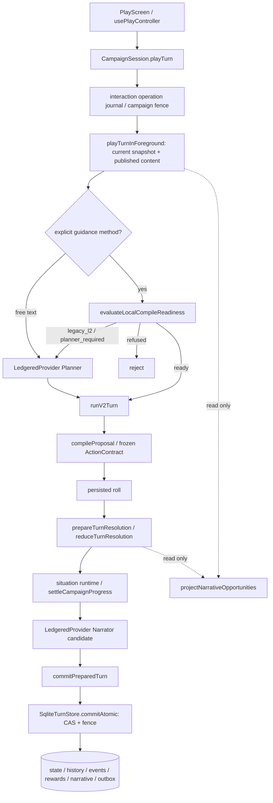

# Production authority map (BEFORE)



| Writer/entry | Authority and boundary | Finding |
|---|---|---|
| `domain/state/types.ts`, `effects.ts` | GameStateSnapshot, clone/applyEffects; rules and validation in domain/turns/contracts.ts | currently unique snapshot contract |
| `application/game/v2Turn.ts`, `v2Compile.ts` | L1 proposal or constrained Planner → same compiler; staged hash and roll journal; prepared before narration | unique compiler/reducer; text routing bypass in Session |
| `application/turns/commitTurn.ts` | reduce once; prepare writes nothing; prepared object committed verbatim | currently unique calculation semantics |
| `infra/sqlite/sqliteTurnStore.ts` | stageRollTurn/recordRoll durable precommit identities; commitAtomic CAS, fence, settlement, projections, snapshot, turn/events, narrative adoption and outbox in transaction | currently unique action commit boundary; preserve |
| `application/campaign/session.ts` | pause/resume and adopted scene actors use commitAtomic; rest/training/party/encounter actions use commitResolvedTurn; discovery, quest and situation progress prepared before commit | multiple legitimate callers, no new writer needed |
| `campaignPlan/settlement.ts` + `domain/campaignPlan/progressReducer.ts` | action/adoption share campaign progress/reward/consequence settlement | unique semantic authority; do not add reward engine |
| `campaignPlan/replanService.ts` | adoptReplanCandidate rejects pending turn, stale hashes and new orphan triggers; commitAtomic with plan/job writes in transactionChanges | management adoption not a dice turn; node reachability duplicates lifecycle |
| `infra/sqlite/sqliteGameStore.ts` | existing skill/relationship/card/encounter projections and legacy request cache APIs | supplementary projections, not a new state model; broad legacy writer isolation not proven |
| `application/export/saveFile.ts`, branch fork/rewind | validated import creates isolated campaign/branch in one transaction; fork restores version-bound projections | separate lifecycle writers, not parallel gameplay settlement |
| `mobile/src/database.ts` | database bootstrap/migrations, interrupted attempts → outcome_unknown, style recovery | no automatic uncertain replay |
| `campaignPlan/opportunityProjection.ts` | current plan/artifacts/runtime → visible opportunities only; no SQL, no mutable progress | read only; repeat computation in Session |
| moduleRegistry.ts | eight manifests / versions / ordering / descriptive ownedFields | not writer isolation; keep bindings unchanged |

## Request origin and recovery map

- Mobile runtime creates Session with scheduler, SQLite ledger and native hash/random; UI never supplies rule effects. Headless/background jobs share scheduling/ledger.
- Session constructor wraps provider via LedgeredProvider (or RateScheduledProvider.withLedger); mobile supplies llmLedger. Tests may explicitly supply raw fakes, not a second production ledger.
- `runV2Turn`: Planner / bounded received-response or reasoning repair, Narrator / bounded repair. Unknown failures exit; local selection must skip Planner.
- Campaign plan candidateJob (opening/replan/successor), guidance enrichment, story/episodic postprocess and encounter creative tasks use existing provider infrastructure. Do not add calls or bypass ledger.
- `application/llm/requestLedger.ts`, requestBudget*.ts and `infra/sqlite/sqliteLlmLedgerStore.ts`: logicalRequestId/attemptId, reservations, leases, received reuse; unapproved outcome_unknown blocks replay. Ledger is operational evidence, never gameplay state.
- Frozen turn root snapshot/context, staged ActionContract hash, rule/content bindings, roll record and narrative candidate remain restart inputs. Commit-before-journal-checkpoint replays existing commit. Cold mobile startup marks interrupted attempts uncertain and requires approval.

Evidence: source audit at baseline SHA above; production integration tests use `tests/helpers/phase9CampaignFixture.cjs`. This is an audited call map, not a claim of complete enforcement of all legacy store APIs.

## Existing commit caller inventory (post-change audit)

Captured at code head `4a1b169`; line numbers are for this head, not baseline. `executeDeterministicTurn` and encounterService are pre-existing callers of the shared commit authority, not new runtime construction. Lifecycle create/fork/import transactions remain described above.

```text
src/application/turns/executeDeterministicTurn.ts:72:  const committed = await commitResolvedTurn({
src/application/turns/commitTurn.ts:146:export async function commitResolvedTurn({
src/application/turns/commitTurn.ts:182:  const stored = await store.commitAtomic({
src/application/turns/commitTurn.ts:290:  const stored = await store.commitAtomic({
src/application/ports/turnStore.ts:73:  commitAtomic(input: AtomicCommitInput): Promise<CommittedTurn>;
src/application/game/v2Turn.ts:777:    result = await commitResolvedTurn({
src/application/campaignPlan/replanService.ts:338:    await input.turns.commitAtomic({ branchId: input.branchId, turnId, expectedStateVersion: state.stateVersion,
src/application/campaign/session.ts:569:    await this.deps.turns.commitAtomic({
src/application/campaign/session.ts:605:    await this.deps.turns.commitAtomic({ branchId: options.branchId, turnId, expectedStateVersion: state.stateVersion, nextState,
src/application/campaign/session.ts:815:    await commitResolvedTurn({
src/application/campaign/session.ts:3347:    await commitResolvedTurn({
src/application/campaign/session.ts:3465:    await commitResolvedTurn({
src/application/campaign/session.ts:3569:    const committed = await commitResolvedTurn({
src/application/campaign/encounterService.ts:307:    const result = await commitResolvedTurn({
src/application/campaign/encounterService.ts:402:    await commitResolvedTurn({
src/application/campaign/encounterService.ts:1267:    const result = await commitResolvedTurn({
src/infra/sqlite/sqliteTurnStore.ts:537:  async commitAtomic(input: AtomicCommitInput): Promise<CommittedTurn> {
src/infra/sqlite/sqliteTurnStore.ts:576:      await this.persistState(
src/infra/sqlite/sqliteTurnStore.ts:1118:  private async persistState(
```
