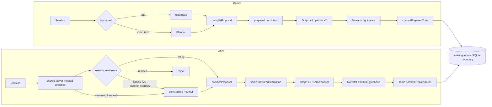
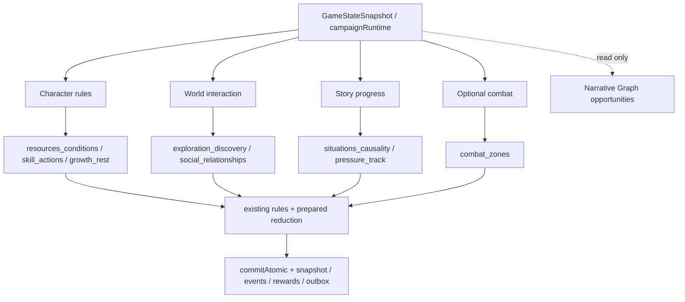

# Runtime convergence: BEFORE / AFTER

Baseline: `1b460fb378614986a3896d487c78e6a180409764`. Production change commits: M1 `e47644d`, M2 `97257c2`, M4 `eec0613`. M3 `6f02d20` preserves the correct Graph implementation. Full pre-change graph and writers: [AUTHORITY_MAP](AUTHORITY_MAP.md).

## Actual reduction

| Same-condition metric | Before | After | Evidence |
|---|---:|---:|---|
| Exact fixed method text: Planner fake-provider dispatch | 1 | 0 | M1 RED stack, text/tap full contract + dice + state + events parity |
| Tap: Planner / Narrator fake dispatch | 0 / 1 | 0 / 1 | existing L1 and new parity regression |
| Graph calls for one prepared version in Session | 4 | 1 | M4 production function-call count regression |
| Public packet builds for same prepared turn | 2 | 1 | same regression; runtime forwards existing packet |
| Node-condition reachability implementations | 2 | 1 | removed replan clone; lifecycle function shared |
| Dead Session blocked-method collections | 2 | 0 | write-only after M1; removed M4 |
| Session source lines | 4174 | 4143 | git show baseline / current wc -l; not a correctness metric |
| Total production source lines | +56 / -90 | net -34 | git diff --numstat baseline -- src |
| Added production files / stores / reducers / schemas | 0 | 0 | diff review |
| Independent action commit authorities added | 0 | 0 | SqliteTurnStore.commitAtomic retained |
| Real matched provider cost / latency reduction | NOT MEASURED | NOT MEASURED | no authorized budget or matched real sample |

A correctness repair accompanies the reduction: deferred transitions use `consequence:<existing idempotencyKey>` instead of colliding with `method:<turnId>`. This is another batch identity within existing processedEventKeys, not a new ledger. Normal action hashes, dice, saved contracts and old keys stay unchanged. Previously discharged broken histories are not silently compensated.

## Four responsibility groups, existing eight manifests

The groups are explanatory only: module IDs, manifest versions, ordering, bindings and save schemas remain intact. `ownedFields` is descriptive metadata, not writer isolation.

## Writer / request / freeze delta

No writer or request-origin file is added. Session, legacy deterministic action/encounter callers and management adoption still use existing commitTurn/commitAtomic; lifecycle create/fork/restore keep their validated transactions. LedgeredProvider remains the physical request governance authority in mobile. The Narrator receives serialized public facts from prepared state and cannot modify the draft. Graph has no persistence. Frozen contract/hash → persisted roll → prepared resolution → Narrator candidate → atomic commit/outbox remains the path.
